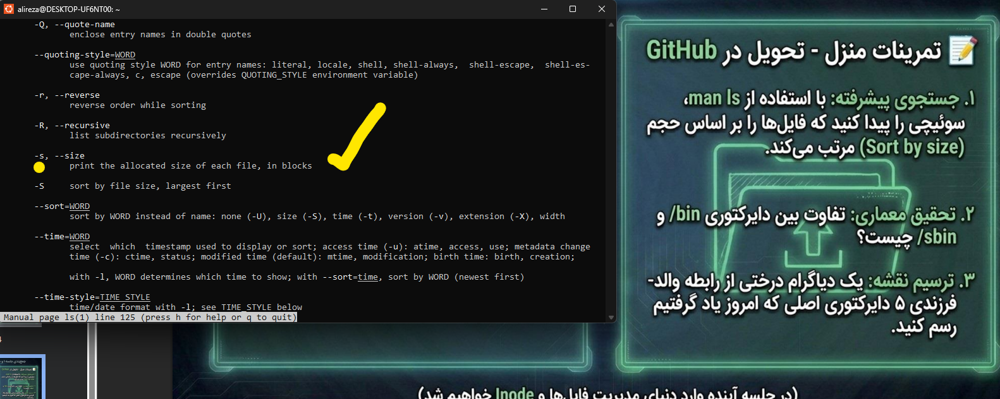
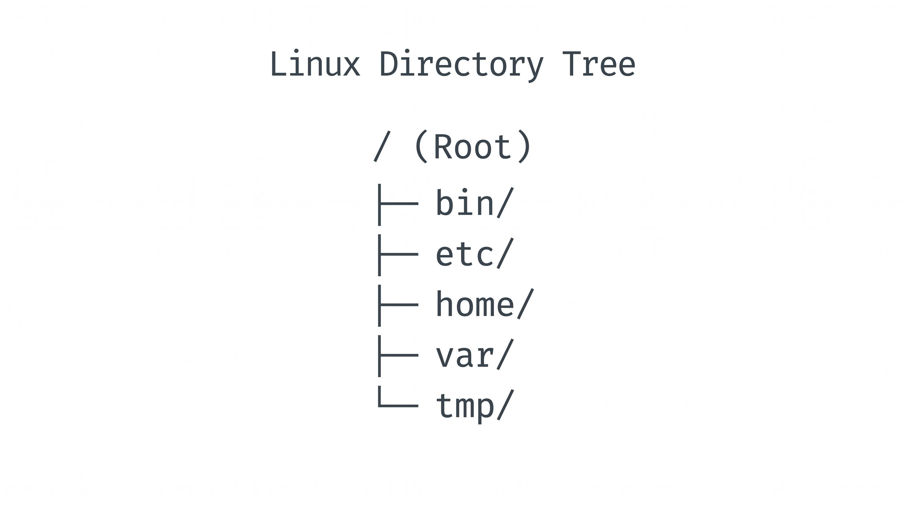

# تفاوت دایرکتوری‌های `/bin` و `/sbin` در لینوکس

در ساختار فایل‌سیستم لینوکس (FHS)، دو مسیر اصلی برای نگهداری فایل‌های اجرایی وجود دارد که بر اساس سطح دسترسی و کاربرد از یکدیگر تفکیک شده‌اند:

### ۱. دایرکتوری `/bin` (User Binaries)
* **کاربرد:** شامل دستورات ضروری، عمومی و روزمره سیستم.
* **سطح دسترسی:** همهٔ کاربران عادی بدون نیاز به مجوز ویژه می‌توانند آن‌ها را اجرا کنند.
* **مثال‌ها:** `ls` ،`cp` ،`cat` ،`mkdir`

### ۲. دایرکتوری `/sbin` (System Binaries)
* **کاربرد:** شامل ابزارهای حیاتی مدیریتی، پیکربندی و نگهداری سیستم.
* **سطح دسترسی:** عمدتاً مختص مدیر سیستم (کاربر `root` یا اجرای از طریق `sudo`).
* **وجه تسمیه:** حرف **s** در ابتدای `sbin` مخفف **System** یا **Superuser** است تا مرز ابزارهای مدیریتی و دستوری کاملاً مشخص باشد.
* **مثال‌ها:** `fdisk` ،`iptables` ،`reboot` ،`fsck`

---

