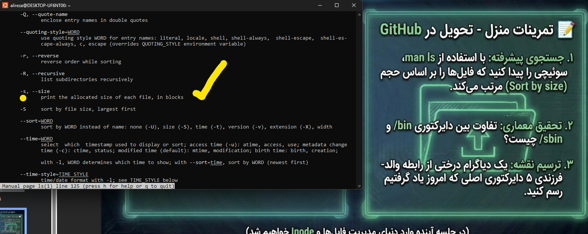

# تمرین ساخت و اجرای پروژه چندفایلی در زبان C با Makefile


------------------------------------------------------------------------

## بخش اول: ساخت پوشه پروژه و فایل‌های C

ابتدا پوشه پروژه را می‌سازیم و وارد آن می‌شویم:

``` bash
mkdir tamrin8
cd tamrin8
```

سپس فایل `helper.c` را ایجاد می‌کنیم:

``` bash
#include <stdio.h>

void greet(void) {
    printf("Hello from helper.c!\n");
}
```

در ادامه فایل `main.c` را ایجاد می‌کنیم:

``` bash
void greet(void);

int main(void) {
    greet();
    return 0;
}
```

در فایل `main.c` تابع `greet` معرفی و در تابع `main` فراخوانی می‌شود.
تعریف این تابع در فایل `helper.c` قرار دارد.

**تصویر بخش اول:**

```{=html}
<!-- تصویر اول ترمینال را در مسیر images/01-create-project.png قرار دهید و خط زیر را از حالت توضیح خارج کنید. -->
```
```{=html}
 
```

------------------------------------------------------------------------

## بخش دوم: ساخت فایل Makefile

برای مدیریت فرایند کامپایل، فایل `Makefile` را با دستور زیر باز می‌کنیم:

``` bash
nano Makefile
```

سپس محتوای زیر را در آن قرار می‌دهیم:

``` makefile
CC = gcc
CFLAGS = -g -Wall

all: my_project

my_project: main.o helper.o
	$(CC) $(CFLAGS) -o my_project main.o helper.o

main.o: main.c
	$(CC) $(CFLAGS) -c main.c

helper.o: helper.c
	$(CC) $(CFLAGS) -c helper.c

clean:
	rm -f main.o helper.o my_project
```

**نکته مهم:** در خطوط دستوری زیر هر هدف (مانند دستورات کامپایل و `rm`)
باید در ابتدای خط از کلید `Tab` استفاده شود، نه Space؛ زیرا `make` به
این موضوع حساس است.

برای ذخیره و خروج از `nano`، کلیدهای `Ctrl + O`، سپس `Enter` و در پایان
`Ctrl + X` را می‌زنیم.

برای بررسی Tabها می‌توانیم دستور زیر را اجرا کنیم:

``` bash
cat -A Makefile
```

در ابتدای خطوط دستوری باید علامت `^I` نمایش داده شود.

**تصویر بخش دوم:**

```{=html}
<!-- تصویر دوم ترمینال را در مسیر images/02-makefile.png قرار دهید و خط زیر را از حالت توضیح خارج کنید. -->
```
```{=html}
<!--  -->
```

------------------------------------------------------------------------

## بخش سوم: کامپایل، اجرا و بررسی عملکرد Makefile

ابتدا دستور زیر را برای کامپایل پروژه اجرا می‌کنیم:

``` bash
make
```

با اجرای این دستور، فایل‌های شیء `main.o` و `helper.o` ساخته شده و سپس به
فایل اجرایی `my_project` لینک می‌شوند.

برای مشاهده فایل‌های موجود در پوشه از دستور زیر استفاده می‌کنیم:

``` bash
ls
```

سپس برنامه را اجرا می‌کنیم:

``` bash
./my_project
```

خروجی مورد انتظار برنامه:

``` text
Hello from helper.c!
```

### بررسی کامپایل مجدد فایل تغییرکرده

برای آزمایش اینکه `Makefile` فقط فایل‌های موردنیاز را دوباره کامپایل
می‌کند، دستورهای زیر را اجرا می‌کنیم:

``` bash
touch helper.c
make
```

با توجه به وابستگی‌های تعریف‌شده در `Makefile`، فایل `helper.c` دوباره
کامپایل می‌شود و فایل اجرایی مجدداً لینک می‌شود؛ اما `main.c` نیازی به
کامپایل مجدد ندارد.

### پاک کردن فایل‌های تولیدشده

در پایان، برای حذف فایل‌های شیء و فایل اجرایی دستور زیر را اجرا می‌کنیم:

``` bash
make clean
ls
```

با اجرای `make clean` فایل‌های `main.o`، `helper.o` و `my_project` حذف
می‌شوند و فایل‌های اصلی پروژه، یعنی `main.c`، `helper.c` و `Makefile` باقی
می‌مانند.

**تصویر بخش سوم:**

```{=html}
<!-- تصویر سوم ترمینال را در مسیر images/03-build-run-clean.png قرار دهید و خط زیر را از حالت توضیح خارج کنید. -->
```
```{=html}
<!--  -->
```

------------------------------------------------------------------------

## نتیجه‌گیری

در این تمرین یک پروژه چندفایلی در زبان C ایجاد کردیم. تابع `greet` در
فایل `helper.c` تعریف شد و از طریق فایل `main.c` فراخوانی شد. سپس با
استفاده از `Makefile` فرایند کامپایل، لینک‌کردن، اجرای برنامه، کامپایل
مجدد فایل تغییرکرده و پاک‌سازی فایل‌های تولیدشده را انجام دادیم.
